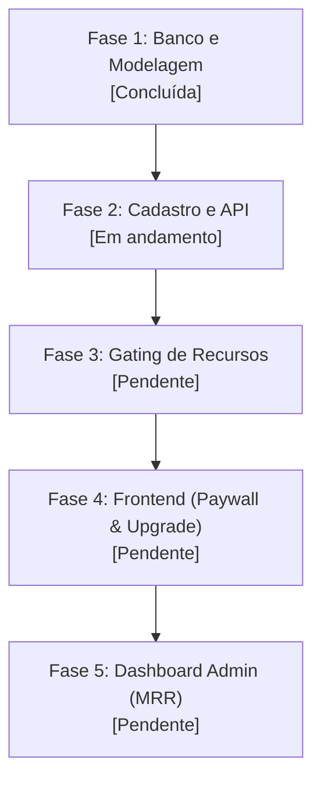

# Plano de Implementação: Módulo de Assinaturas (SaaS)

Este documento estabelece o roadmap arquitetural e funcional para a transição do **FinControl** de um sistema fechado para um modelo de negócios **Freemium (SaaS Tiering)**, com planos Free e Pro. Ele orienta as equipes de engenharia e os agentes de IA durante a execução das fases do projeto.

---

## 1. Objetivo

Transformar o FinControl em uma plataforma SaaS escalável e sustentável, viabilizando o autosserviço (self-service) para novos usuários através de um plano de entrada gratuito (**Free**) com limites operacionais pré-estabelecidos e uma modalidade avançada (**Pro**) com limites ilimitados e recursos corporativos.

---

## 2. Visão Geral dos Planos

| Recurso / Parâmetro | Plano Free | Plano Pro |
|---|:---:|:---:|
| **Valor Mensal** | **R$ 0,00** | **R$ 29,90** |
| **Limite de Contas Financeiras** | **Até 2 contas** | **Ilimitado** |
| **Limite de Lançamentos Mensais** | **Até 50 transações/mês** | **Ilimitado** |
| **Categorias Personalizadas** | Sim | Sim |
| **Relatórios e Análises Avançadas** | Básico | Completo |
| **Suporte** | Comunitário | Prioritário |

---

## 3. Fases de Desenvolvimento

---

### Fase 1: Banco de Dados e Modelagem Relacional
**Status:** `[Concluída]` ✅

- **Migration Flyway `V21`:**
  - Criação da tabela `plano` com restrição de unicidade no nome (`lower(nome)`), campos de limites operacionais (`limite_contas`, `limite_transacoes_mes`) e precisão monetária (`valor_mensal NUMERIC(15,2)`).
  - Criação da tabela `assinatura` vinculando o usuário (`usuario_id`) ao plano contratado (`plano_id`), com controle de vigência (`data_inicio`, `data_fim`) e status tipado.
  - Índices de performance para busca por usuário e plano.
  - *Seed* inicial dos planos no banco de dados (`Free` a R$ 0,00 e `Pro` a R$ 29,90).
- **Entidades JPA correspondentes:**
  - `Plano.java` herdando de `DefaultEntity`.
  - `Assinatura.java` herdando de `DefaultEntity` e garantindo o isolamento de dados com `@JoinColumn(name = "usuario_id", nullable = false)`.
  - Enum `StatusAssinatura.java` (`ATIVA`, `CANCELADA`, `PENDENTE`, `EXPIRADA`).

---

### Fase 2: Integração no Cadastro e Endpoints de API
**Status:** `[Em andamento]` 🟡

- **Camada de Repositório e Serviço:**
  - Criação de `PlanoRepository` e `AssinaturaRepository` estendendo `PanacheRepositoryBase`.
  - Criação de `AssinaturaService` responsável por gerenciar ativações, trocas de plano (upgrades/downgrades) e verificação de vigência.
- **Vínculo Automático no Registro:**
  - Alteração no `UsuarioService.criar()` para associar automaticamente uma assinatura ativa do plano **Free** a todo novo usuário cadastrado pelo fluxo público.
- **Recurso REST (`AssinaturaResource`):**
  - `GET /assinaturas/me`: Consulta do plano atual do usuário logado, status da assinatura e consumo atual dos limites (ex.: "32 de 50 transações utilizadas").
  - `GET /planos`: Listagem pública dos planos disponíveis para exibição de contratação.
  - `POST /assinaturas/upgrade`: Solicitação de migração para o plano Pro (preparando o terreno para o gateway de pagamento).

---

### Fase 3: Gating de Recursos (Limites do Plano Free)
**Status:** `[Concluída] ✅`

- **Gating de Lançamentos (`TransacaoService`):**
  - Antes de persistir uma nova transação (`create`), o serviço valida o total de lançamentos do usuário no mês de competência.
  - Se o usuário estiver no plano Free e atingir o teto de 50 transações no mês, a requisição é bloqueada com erro de negócio padronizado (**HTTP 402 Payment Required** ou **403 Forbidden** com RFC 7807 explicativo).
- **Gating de Contas Financeiras (`ContaFinanceiraService`):**
  - Antes de criar uma nova conta financeira (`criar`), o serviço valida a quantidade de contas ativas do usuário.
  - Bloqueio imediato caso o usuário no plano Free tente cadastrar uma 3ª conta financeira ativa.
- **Exceção para `SUPER_ADMIN`:**
  - Contas administrativas não sofrem bloqueios de limites operacionais.

---

### Fase 4: Frontend (Paywall e Fluxo de Upgrade)
**Status:** `[Concluída] ✅`

- **Interface de Planos (`components/planos`):**
  - Tela comparativa de planos (cards de preço e benefícios do Free vs Pro).
  - Indicadores visuais de consumo nos menus e cabeçalhos (ex.: barra de progresso de lançamentos do mês).
- **Interceptor de Limite / Paywall Modal:**
  - `HttpInterceptor` captura códigos de erro disparados por atingimento de limite (402 ou 403 com código de domínio específico).
  - Abertura de modal amigável de *Paywall* contextual: *"Você atingiu o limite de 50 lançamentos mensais do plano Free. Faça upgrade para o Pro para continuar sem limites!"*.
  - Redirecionamento direto para a tela de upgrade com opção de confirmação.

---

### Fase 5: Dashboard do Administrador (Métricas SaaS & MRR)
**Status:** `[Concluída] ✅`

- **Novos Endpoints em `AdminResource` e `PainelAdminService`:**
  - `GET /admin/metricas-saas`:
    - **MRR (Monthly Recurring Revenue):** Soma da receita mensal projetada dos assinantes ativos do plano Pro.
    - **Taxa de Conversão:** Percentual de usuários da base que migraram do Free para o Pro.
    - **Churn Rate:** Taxa de cancelamento de assinaturas pagas por período.
    - **Distribuição de Assinantes:** Proporção visual de usuários Free vs Pro.
- **Componentes Visuais no Angular:**
  - Novos cards de métricas financeiras de negócio no painel do administrador (`/admin/dashboard`).
  - Gráfico de pizza/rosca demonstrando a distribuição da base de usuários por plano.

---

## 4. Diretrizes de Governança para Agentes de IA

Ao atuar em qualquer tarefa deste módulo, o agente de IA deve respeitar:
1. **Isolamento de Dados:** Consultas de assinaturas e limites devem sempre estar amarradas ao `usuario_id` extraído do token JWT autenticado.
2. **Arquitetura em Camadas:** O gating de limites operacionais pertence obrigatoriamente à camada `Service` (ex.: `TransacaoServiceImpl`, `ContaFinanceiraService`), nunca aos `Resources`.
3. **Erros Padronizados:** Mensagens de bloqueio por atingimento de plano devem utilizar o padrão RFC 7807 (*Problem Details*) com títulos claros e campo `detail` orientando o usuário sobre o upgrade.
4. **Registro de Mudanças:** Toda etapa concluída deve ser atualizada neste documento e catalogada no `AGENTS.md`.
