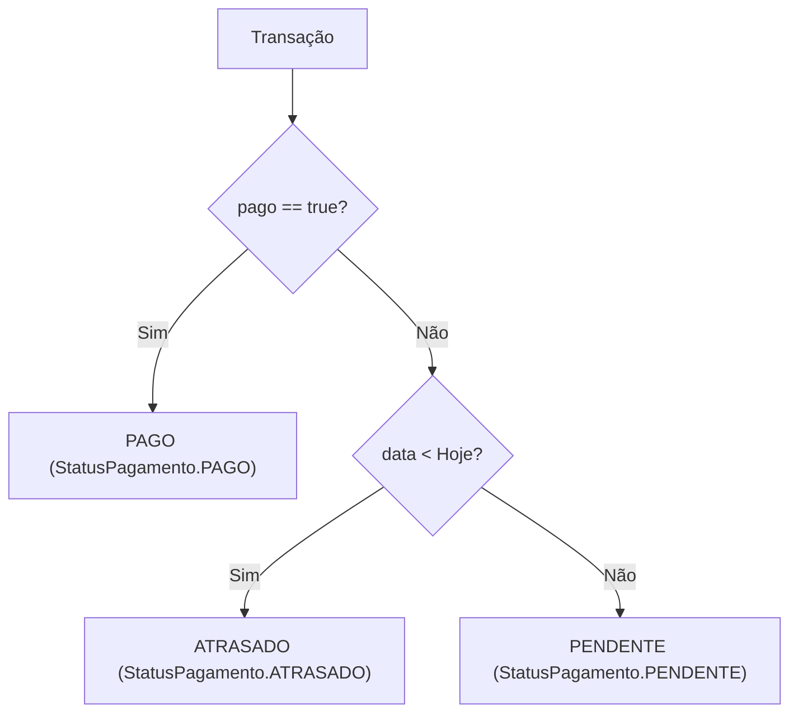
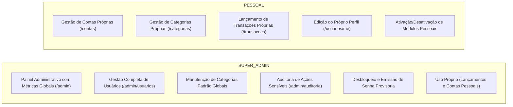

# Regras de Negócio e Validações — FinControl

Este documento descreve as regras de negócio, comportamentos das entidades, restrições de integridade, validações de entrada e diretrizes de segurança implementadas no backend do **FinControl**.

---

## 1. Entidades Principais

| Entidade | Papel e Responsabilidades |
|---|---|
| **`Usuario`** | Representa o titular da conta no sistema. Gerencia o acesso através de credenciais criptografadas (BCrypt), define o perfil de permissão (`PESSOAL` ou `SUPER_ADMIN`), armazena os módulos habilitados (`usuario_modulo`), controla bloqueios por tentativas incorretas de login (`tentativasLogin`, `bloqueadoAte`), invalidação de sessões ativas (`versaoSessao`) e a obrigatoriedade de substituição de senhas provisórias (`trocarSenha`). |
| **`ContaFinanceira`** | Representa o local de custódia do dinheiro (ex.: Carteira, Conta Corrente, Poupança, Investimentos). Possui um saldo inicial cadastrado e um estado de disponibilidade (`ativa`). Serve de destino obrigatório para os lançamentos financeiros. |
| **`Categoria`** | Estrutura de organização das movimentações financeiras. Possui tipo estrito (`RECEITA` ou `DESPESA`), identificação visual (cor em hexadecimal e ícone do Material Icons) e garantia de unicidade de nome por usuário. |
| **`Transacao`** | Representa uma movimentação de receita ou despesa vinculada obrigatoriamente a uma conta, uma categoria e ao usuário proprietário. Contém descrição, valor, data de competência/vencimento, status de liquidação (`pago`) e data efetiva de pagamento. |
| **`RegistroAuditoria`** | Log persistente e imutável que audita eventos administrativos críticos (alteração de perfil, bloqueio/desbloqueio, desativação, emissão de senha provisória). Registra autor (`autor_id`, `autor_email`), ação, alvo e detalhes sem chave estrangeira estrita, preservando a rastreabilidade histórica. |

---

## 2. Regras de Negócio

### 2.1. Como o Saldo é Calculado (Apenas Transações Pagas)
- **Saldos não são gravados estaticamente no banco:** Para garantir consistência em concorrência e evitar descompasso em edições retroativas, o saldo atual de uma conta nunca é armazenado em uma coluna física. Ele é derivado dinamicamente a cada consulta.
- **Impacto exclusivo de lançamentos pagos:**
  $$\text{Saldo Atual} = \text{Saldo Inicial} + \sum (\text{Receitas Pagas}) - \sum (\text{Despesas Pagas})$$
  Lançamentos pendentes ou atrasados não afetam o saldo real disponível.
- **Saldo Previsto (Projeção do Mês):**
  Para planejamento orçamentário mensal (`YearMonth`), o sistema projeta o saldo até o encerramento do mês:
  $$\text{Saldo Previsto} = \text{Saldo Atual} + \sum (\text{Receitas Pendentes até o Fim do Mês}) - \sum (\text{Despesas Pendentes até o Fim do Mês})$$
- **Saldo inicial negativo:** É explicitamente permitido no cadastro da conta financeira, contemplando contas que já iniciam em situação de cheque especial ou saldo devedor.

---

### 2.2. Diferença entre Transação Pendente, Paga e Atrasada
A situação de uma transação não é gravada diretamente como texto no banco; ela é avaliada dinamicamente pelo método `getStatus()` da entidade `Transacao` e exposta via enum `StatusPagamento`:

1. **`PAGO` (`pago = true`):**
   - Indica que o valor já entrou ou saiu da conta.
   - Possui obrigatoriamente `dataPagamento` informada.
   - **Regra de data futura:** A `dataPagamento` **não pode ser posterior à data atual** (`LocalDate.now()`). O sistema bloqueia pagamentos com liquidação no futuro (devem ser mantidos como pendentes).
   - Pode ser marcada como paga via `PATCH /transacoes/{id}/pagar`, com opção de redirecionar a conta de liquidação.
2. **`PENDENTE` (`pago = false` e `data >= LocalDate.now()`):**
   - Movimentação programada cujo vencimento é o dia atual ou uma data futura.
   - Representa compromissos a pagar ou créditos a receber previstos.
   - Não afeta o saldo atual da conta.
3. **`ATRASADO` (`pago = false` e `data < LocalDate.now()`):**
   - Transação cujo vencimento já expirou e ainda não foi marcada como paga.
   - Não afeta o saldo atual da conta.
4. **Reabertura (`PATCH /transacoes/{id}/reabrir`):**
   - Permite desfazer a quitação de uma transação, voltando a flag para `pago = false`, limpando a `dataPagamento` e recalculando o saldo da conta imediatamente.

---

### 2.3. Regras de Exclusão e Integridade Referencial

- **Exclusão de Conta Financeira (`ContaFinanceiraService`):**
  - **Bloqueio por lançamentos vinculados:** É estritamente proibido excluir contas que possuam qualquer transação associada (paga ou pendente). O usuário deve utilizar o **arquivamento** (`ativa = false`), que esconde a conta de novos lançamentos sem violar o histórico financeiro.
  - **Obrigatoriedade de conta ativa:** O usuário não pode excluir nem arquivar sua última conta ativa. O sistema exige a existência de pelo menos uma conta ativa por titular.
- **Exclusão de Categoria (`CategoriaServiceImpl`):**
  - Uma categoria vinculada a transações não pode ser excluída (evita violação de chave estrangeira).
  - **Bloqueio de alteração de tipo:** Não é permitido mudar o tipo de uma categoria (`RECEITA` $\leftrightarrow$ `DESPESA`) se já existirem transações vinculadas a ela.
  - **Compatibilidade de tipo:** Lançamentos de despesa só aceitam categorias de despesa; receitas só aceitam categorias de receita.
- **Exclusão de Usuário (`AdminUsuarioService`):**
  - **Regra do histórico financeiro e de auditoria:** Um usuário **só pode ser excluído se nunca tiver registrado lançamentos** (`transacaoRepository.count == 0`) e **não possuir ações na auditoria**.
  - Caso possua qualquer histórico, a exclusão é rejeitada pelo sistema; o administrador deve optar pela **desativação** (`ativo = false`), suspendendo o acesso e preservando os registros.
  - Ao excluir um usuário elegível (sem histórico), suas contas e categorias iniciais são excluídas em cascata.
  - Nenhum administrador pode excluir ou desativar a si mesmo.
  - O sistema impede a desativação ou exclusão do último `SUPER_ADMIN` ativo da plataforma.

---

### 2.4. Regra de Isolamento de Dados (Prevenção contra IDOR)
- **Associação obrigatória por usuário:** Todas as entidades de domínio (`ContaFinanceira`, `Categoria`, `Transacao`) são amarradas diretamente ao ID do usuário autenticado (`usuario_id`).
- **Resolução via JWT:** O backend extrai a identidade do usuário a partir do token (`jwt.getName()`) e propaga o contexto de segurança para as consultas nos repositórios (`findByDonoAndId`).
- **Ocultação de recursos de terceiros:** Caso um usuário tente acessar, alterar ou deletar um ID pertencente a outro usuário, o sistema retorna **404 Not Found** em vez de 403 Forbidden. Dessa forma, a aplicação não revela a terceiros se aquele identificador existe ou não no banco.

---

## 3. Validações de Entrada e Campos

### 3.1. Validação de Senha Forte (`@SenhaForte`)
Exigida no cadastro público, alteração voluntária de senha e criação manual de usuários:
- **Tamanho:** Mínimo de 6 e máximo de 100 caracteres.
- **Critérios de complexidade:**
  - Pelo menos 1 letra maiúscula (`\p{Lu}`);
  - Pelo menos 1 letra minúscula (`\p{Ll}`);
  - Pelo menos 1 dígito numérico (`\p{Nd}`);
  - Pelo menos 1 caractere especial (ex.: `@`, `#`, `$`, `%`, `&`, `*`).
- **Confirmação:** A confirmação de senha deve ser rigorosamente idêntica à senha.
- **Exigência da senha atual:** Qualquer alteração sensível na própria conta (troca de senha, troca de e-mail ou atualização cadastral) exige a digitação da senha atual como mecanismo de reautenticação.

### 3.2. Validação de Telefone (`@Telefone`)
- Suporta formatos telefônicos brasileiros (DDD + número).
- Aceita pontuação na entrada (ex.: `(63) 99999-0000`).
- Higienização: persistência de dígitos numéricos apenas.
- Regras de composição:
  - Fixo: 10 dígitos (DDD não iniciado por `0`).
  - Celular: 11 dígitos (DDD não iniciado por `0` e terceiro dígito igual a `9`).

### 3.3. Limites de Caracteres e Obrigatoriedades

| Recurso / DTO | Campo | Regras e Limites |
|---|---|---|
| **Usuário** | `nome` | Obrigatório, entre 2 e 100 caracteres. |
| | `email` | Obrigatório, formato de e-mail válido RFC, máximo de 254 caracteres, único no sistema, normalizado para minúsculas (`trim().toLowerCase()`). |
| | `profissao` | Obrigatória para perfil `PESSOAL`, máximo de 100 caracteres. |
| | `telefone` | Obrigatório, formato `@Telefone` (10 ou 11 dígitos). |
| **Conta Financeira** | `nome` | Obrigatório, entre 2 e 60 caracteres. |
| | `tipo` | Obrigatório (`TipoContaFinanceira`: `CARTEIRA`, `CONTA_CORRENTE`, `POUPANCA`, `INVESTIMENTO`, `OUTROS`). |
| | `saldoInicial` | Obrigatório, numérico com até 13 inteiros e 2 casas decimais (pode ser negativo). |
| | `cor` | Opcional, formato hexadecimal (`#RGB` ou `#RRGGBB`). |
| **Categoria** | `nome` | Obrigatório, entre 2 e 60 caracteres, único por usuário. |
| | `tipo` | Obrigatório (`TipoCategoria`: `RECEITA` ou `DESPESA`). |
| | `cor` | Opcional, formato hexadecimal (`#RGB` ou `#RRGGBB`), máximo de 20 caracteres. |
| | `icone` | Opcional, identificador do Material Icons (`^[a-z0-9_]{2,40}$`). |
| **Transação** | `descricao` | Obrigatória, entre 2 e 150 caracteres. |
| | `valor` | Obrigatório, estritamente positivo (`> 0`), até 13 inteiros e 2 decimais. |
| | `data` | Obrigatória (data de vencimento ou competência). |
| | `tipo` | Obrigatório (`RECEITA` ou `DESPESA`), compatível com o tipo da categoria. |
| | `idCategoria` | Obrigatório, pertencente ao próprio usuário logado. |
| | `idConta` | Opcional (se omitido, o sistema associa à conta ativa mais antiga do usuário). |
| | `dataPagamento` | Opcional se pendente; obrigatória se paga; nunca futura. |
| **Paginação** | `page`, `pageSize` | `page >= 0`; `pageSize` entre 1 e 100. |

---

## 4. Segurança, Perfis e Controle de Acesso

### 4.1. Matriz de Operações: `PESSOAL` vs `SUPER_ADMIN`

| Funcionalidade | Perfil `PESSOAL` | Perfil `SUPER_ADMIN` |
|---|:---:|:---:|
| Auto-cadastro público (`POST /auth/register`) | ✅ Aberto | ❌ Criado somente por outro admin |
| Gerenciar Contas, Categorias e Transações Próprias | ✅ Próprias | ✅ Próprias |
| Editar Próprio Perfil e Trocar Própria Senha (`/usuarios/me`) | ✅ | ✅ |
| Habilitar / Desabilitar Módulos Pessoais | ✅ | ❌ Possui todos os módulos nativamente |
| Acessar Painel com Métricas Globais (`/admin`) | ❌ 403 Forbidden | ✅ |
| Pesquisar / Listar Todos os Usuários do Sistema | ❌ 403 Forbidden | ✅ |
| Consultar Ficha Cadastral de Outros Usuários | ❌ 403 Forbidden | ✅ (Sem visualização de extratos/valores) |
| Ativar, Desativar ou Desbloquear Usuários | ❌ 403 Forbidden | ✅ (Exceto a si mesmo e último admin) |
| Gerar Senha Provisória para Outros Usuários | ❌ 403 Forbidden | ✅ (Registrado em auditoria) |
| Gerenciar Modelos de Categorias Padrão | ❌ 403 Forbidden | ✅ |
| Consultar Logs de Auditoria do Sistema | ❌ 403 Forbidden | ✅ |

---

### 4.2. Funcionamento da Senha Provisória
Mecanismo de contingência para redefinição de acesso iniciada por um administrador:

1. **Geração Segura (`SenhaProvisoria`):**
   - O administrador aciona `POST /admin/usuarios/{id}/senha-provisoria`.
   - O sistema gera aleatoriamente uma senha de 10 caracteres utilizando `SecureRandom`, contemplando maiúsculas, minúsculas, números e caracteres especiais, e excluindo caracteres visualmente ambíguos (como `I`, `l`, `O`, `0`, `1`).
2. **Atualização da Conta:**
   - A senha provisória é convertida em hash BCrypt.
   - A flag `trocarSenha` é definida como `true`.
   - As tentativas erradas de login e bloqueios existentes são limpos.
   - A versão da sessão (`versaoSessao`) é incrementada, invalidando imediatamente qualquer token JWT pré-existente do usuário.
3. **Registro em Auditoria:**
   - O evento é registrado como `SENHA_PROVISORIA_GERADA`, gravando autor, alvo e data, **sem jamais registrar a senha gerada**.
4. **Intercepção pelo Filtro de Segurança (`AcessoFilter`):**
   - Ao se autenticar com a senha provisória, o usuário obtém um token JWT com permissões restritas pela flag `trocarSenha`.
   - Se o usuário tentar acessar qualquer endpoint comum da API, o `AcessoFilter` bloqueia a requisição retornando **403 Forbidden** (*"Troque a senha provisória antes de continuar."*).
5. **Endpoints Liberados (`@PermiteSenhaProvisoria`):**
   - Apenas endpoints explicitamente anotados com `@PermiteSenhaProvisoria` são liberados:
     - `GET /usuarios/me` (consulta cadastral própria);
     - `PUT /usuarios/me/senha` (substituição obrigatória por senha definitiva).
6. **Desbloqueio:**
   - Assim que o usuário conclui o `PUT /usuarios/me/senha` cadastrando sua nova senha forte, a flag `trocarSenha` é redefinida para `false` e o acesso completo à aplicação é liberado.

---

### 4.3. Proteção contra Ataques de Força Bruta e Invalidação de Sessão
- **Controle de Tentativas (`ControleDeSenha`):**
  - Limite de 5 tentativas consecutivas com senha incorreta.
  - Ao atingir a 5ª falha, a conta entra em estado de bloqueio automático por **15 minutos** com retorno HTTP **429 Too Many Requests**.
  - O bloqueio gera um evento de auditoria (`CONTA_BLOQUEADA`).
  - Sucessos de autenticação resetam o contador imediatamente.
  - O administrador tem autoridade para realizar o desbloqueio manual antecipado (`POST /admin/usuarios/{id}/desbloquear`).
- **Invalidação Instantânea de Sessões (Claim `sv`):**
  - O JWT emitido contém a claim `sv` (*session version*).
  - Sempre que o usuário troca sua senha, altera seu e-mail ou clica em *"encerrar outras sessões"*, a coluna `versao_sessao` é incrementada no banco.
  - O `AcessoFilter` recusa qualquer requisição cujo token carregue uma versão de sessão divergente da versão atual do banco (**401 Unauthorized**), garantindo revogação instantânea de sessões sem complexidade de listas negras em cache.

