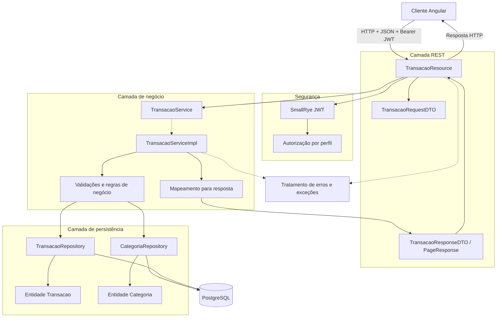

# Diagrama de Arquitetura em Camadas — Backend

## 1. Objetivo

Este diagrama apresenta a organização lógica do backend do FinControl e o fluxo de uma operação de gerenciamento de transações financeiras.

A arquitetura separa as responsabilidades em camadas:

1. Camada REST, responsável pela comunicação HTTP.
2. Camada de negócio, responsável pelas regras da aplicação.
3. Camada de persistência, responsável pelo acesso aos dados.
4. Banco de dados, responsável pelo armazenamento persistente.

A autenticação e a autorização são aplicadas conforme a configuração de segurança do backend.

## 2. Diagrama

## 3. Responsabilidades das camadas

### 3.1. Camada REST

A camada REST expõe os endpoints utilizados pelo frontend.

No fluxo representado, `TransacaoResource` recebe a requisição e encaminha a operação para a camada de negócio.

O contrato de entrada é representado por `TransacaoRequestDTO`, enquanto a resposta pode utilizar `TransacaoResponseDTO` e estruturas de paginação, conforme o endpoint.

Essa separação evita que o contrato HTTP dependa diretamente da representação interna das entidades persistidas.

### 3.2. Segurança

O mecanismo de segurança valida o token JWT e aplica as regras de autorização configuradas para os endpoints.

A identidade do usuário autenticado é utilizada pela aplicação para determinar quais dados podem ser acessados.

A validação do token não elimina a necessidade de verificar a propriedade de registros individuais.

### 3.3. Camada de negócio

A camada de negócio concentra as regras que devem ser respeitadas durante as operações.

No gerenciamento de transações, essas regras incluem:

- Validar os dados recebidos.
- Identificar o usuário autenticado.
- Verificar a existência da categoria informada.
- Confirmar que a categoria pertence ao usuário.
- Verificar a compatibilidade entre o tipo da categoria e o tipo da transação.
- Aplicar as operações de criação, consulta, atualização ou exclusão.

O contrato de serviço é representado por `TransacaoService`, e sua implementação concreta, por `TransacaoServiceImpl`.

### 3.4. Camada de persistência

Os repositórios encapsulam as operações de consulta e persistência.

`TransacaoRepository` é associado às operações de transação, enquanto `CategoriaRepository` é utilizado para consultar e validar categorias.

A persistência é realizada por meio da infraestrutura de Hibernate ORM/Panache configurada no projeto.

### 3.5. Banco de dados

O PostgreSQL armazena os registros persistentes.

As operações de leitura e escrita são coordenadas pelo backend, respeitando as regras de negócio e os mecanismos de integridade definidos na aplicação e no banco.

### 3.6. Tratamento de erros

Falhas de validação, autenticação, autorização ou acesso aos dados devem ser convertidas em respostas HTTP compatíveis com o contrato da API.

O diagrama representa essa responsabilidade de forma conceitual; os nomes exatos dos mapeadores de exceções devem corresponder às classes existentes no backend.

## 4. Fluxo de uma operação

O fluxo simplificado de uma operação de transação é o seguinte:

1. O cliente envia uma requisição HTTP com os dados necessários.
2. O backend processa a autenticação e a autorização.
3. `TransacaoResource` recebe e encaminha a requisição.
4. A camada de negócio valida os dados e as regras aplicáveis.
5. Os repositórios consultam ou alteram os registros no PostgreSQL.
6. A camada de negócio prepara o resultado da operação.
7. O resource retorna a resposta HTTP ao cliente.

A ordem interna pode variar de acordo com a operação e com a configuração de segurança do Quarkus.

## 5. Princípios arquiteturais

### Separação de responsabilidades

Cada camada possui uma função específica. A camada REST trata a comunicação, a camada de negócio aplica as regras e a camada de persistência gerencia o acesso aos dados.

### Validação no servidor

Os dados enviados pelo frontend devem ser validados no backend. A validação realizada na interface é complementar e não substitui as verificações do servidor.

### Proteção dos dados

A identidade autenticada deve ser considerada nas consultas e modificações de dados individuais. Um usuário não deve conseguir manipular registros de outra conta simplesmente alterando um identificador enviado na requisição.

### Contratos explícitos

Os DTOs permitem definir os dados aceitos e devolvidos pela API sem expor indiscriminadamente os detalhes internos das entidades.

## 6. Observações técnicas

1. O diagrama representa a arquitetura lógica, não todos os detalhes de implementação do Quarkus.
2. O relacionamento entre `TransacaoService` e `TransacaoServiceImpl` representa o contrato e sua implementação.
3. A existência de DTOs, repositórios e mappers específicos deve ser conferida no código-fonte antes de alterar seus nomes no diagrama.
4. O banco de dados não deve ser acessado diretamente pelo frontend.
5. A autenticação e a autorização devem continuar protegidas no backend, mesmo que o Angular também possua guards.
6. O diagrama deve acompanhar alterações nas camadas, nos contratos da API ou nas regras de negócio.