# Diagrama de Casos de Uso — FinControl

## 1. Objetivo

Este diagrama apresenta as principais funcionalidades do sistema FinControl e a interação entre os atores externos e o sistema.

O sistema possui dois perfis de usuário:

- **USER:** pode gerenciar sua própria conta, consultar o dashboard e realizar operações sobre suas próprias transações e categorias.
- **ADMIN:** possui as mesmas funcionalidades de um usuário comum para gerenciar seus próprios dados, além de consultar estatísticas financeiras agregadas e administrar parâmetros fiscais.

O perfil `ADMIN` não possui acesso às transações individuais de outros usuários.

As funcionalidades ainda não implementadas são identificadas como futuras e não devem ser interpretadas como recursos disponíveis na versão atual.

## 2. Diagrama

```mermaid
flowchart LR
    User["Ator: Usuário (USER)"]
    Admin["Ator: Administrador (ADMIN)"]
    Scheduler["Agendador do sistema (futuro)"]
    ViaCEP["API externa ViaCEP (futuro)"]

    subgraph System["Sistema FinControl"]

        subgraph Auth["Autenticação e perfil"]
            U1([Cadastrar conta])
            U2([Realizar login])
            U3([Encerrar sessão no frontend])
            U4([Consultar e atualizar próprio perfil])
        end

        subgraph Finance["Gestão financeira"]
            F1([Consultar dashboard])
            F2([Listar e pesquisar transações próprias])
            F3([Consultar detalhes de transação])
            F4([Cadastrar transação])
            F5([Editar transação])
            F6([Excluir transação])
            F7([Listar categorias próprias])
            F8([Cadastrar categoria])
            F9([Editar categoria])
            F10([Excluir categoria sem transações vinculadas])
        end

        subgraph AdminOps["Administração"]
            A1([Consultar estatísticas agregadas])
            A2([Consultar parâmetros fiscais])
            A3([Cadastrar parâmetro fiscal])
            A4([Editar parâmetro fiscal])
            A5([Excluir parâmetro fiscal])
        end

        subgraph Future["Funcionalidades futuras — não implementadas"]
            X1([Configurar transações recorrentes])
            X2([Gerar transações recorrentes automaticamente])
            X3([Definir metas e receber alertas])
            X4([Projetar resultado financeiro mensal])
            X5([Exportar relatório mensal em CSV])
            X6([Calcular tributos PF, MEI e ME])
            X7([Consultar endereço por CEP])
        end
    end

    User --- U1
    User --- U2
    User --- U3
    User --- U4
    User --- F1
    User --- F2
    User --- F3
    User --- F4
    User --- F5
    User --- F6
    User --- F7
    User --- F8
    User --- F9
    User --- F10

    Admin --- U4
    Admin --- F1
    Admin --- F2
    Admin --- F3
    Admin --- F4
    Admin --- F5
    Admin --- F6
    Admin --- F7
    Admin --- F8
    Admin --- F9
    Admin --- F10
    Admin --- A1
    Admin --- A2
    Admin --- A3
    Admin --- A4
    Admin --- A5

    User -.-> X1
    Scheduler -.-> X2
    User -.-> X3
    User -.-> X4
    User -.-> X5
    User -.-> X6
    ViaCEP -.-> X7

    classDef future stroke-dasharray: 5 5
    class X1,X2,X3,X4,X5,X6,X7 future
```

## 3. Descrição dos casos de uso

### 3.1. Autenticação e perfil

| Caso de uso | Ator | Descrição |
|---|---|---|
| Cadastrar conta | USER | Cria uma nova conta no sistema. |
| Realizar login | USER / ADMIN | Autentica o usuário e permite o acesso às funcionalidades autorizadas para seu perfil. |
| Encerrar sessão no frontend | USER / ADMIN | Remove o token de autenticação armazenado localmente no frontend. |
| Consultar e atualizar próprio perfil | USER / ADMIN | Permite consultar e atualizar as informações do próprio perfil. |

### 3.2. Gestão financeira

| Caso de uso | Ator | Descrição |
|---|---|---|
| Consultar dashboard | USER / ADMIN | Apresenta indicadores financeiros calculados a partir dos dados do próprio usuário. |
| Listar e pesquisar transações próprias | USER / ADMIN | Permite consultar as transações pertencentes ao usuário autenticado. |
| Consultar detalhes de transação | USER / ADMIN | Permite visualizar os dados de uma transação própria. |
| Cadastrar transação | USER / ADMIN | Registra uma nova receita ou despesa. |
| Editar transação | USER / ADMIN | Atualiza uma transação pertencente ao usuário autenticado. |
| Excluir transação | USER / ADMIN | Remove uma transação própria. |
| Listar categorias próprias | USER / ADMIN | Consulta as categorias disponíveis para o usuário. |
| Cadastrar categoria | USER / ADMIN | Cria uma categoria financeira. |
| Editar categoria | USER / ADMIN | Atualiza uma categoria própria. |
| Excluir categoria sem transações vinculadas | USER / ADMIN | Exclui uma categoria quando não existem transações associadas a ela. |

### 3.3. Administração

| Caso de uso | Ator | Descrição |
|---|---|---|
| Consultar estatísticas agregadas | ADMIN | Consulta indicadores consolidados do sistema, sem acesso às transações individuais de terceiros. |
| Consultar parâmetros fiscais | ADMIN | Consulta os parâmetros fiscais cadastrados. |
| Cadastrar parâmetro fiscal | ADMIN | Registra um novo parâmetro fiscal. |
| Editar parâmetro fiscal | ADMIN | Atualiza um parâmetro fiscal existente. |
| Excluir parâmetro fiscal | ADMIN | Remove um parâmetro fiscal existente. |

### 3.4. Funcionalidades futuras

Os seguintes casos de uso representam evoluções planejadas e não funcionalidades disponíveis na versão atual:

- Configuração e geração automática de transações recorrentes.
- Definição de metas financeiras e emissão de alertas.
- Projeção do resultado financeiro mensal.
- Exportação de relatórios mensais em CSV.
- Cálculo de tributos para pessoa física, MEI e microempresa.
- Consulta de endereço por CEP por meio de serviço externo.

## 4. Regras e observações

1. Os perfis `USER` e `ADMIN` compartilham as funcionalidades de gestão dos próprios dados financeiros.
2. As operações administrativas adicionais são restritas ao perfil `ADMIN`.
3. As estatísticas administrativas são agregadas; o perfil administrativo não deve consultar transações individuais de outros usuários.
4. Uma categoria não pode ser excluída enquanto possuir transações vinculadas.
5. O encerramento da sessão é realizado no frontend pela remoção do token armazenado localmente. Não existe endpoint de logout no backend.
6. O diagrama não representa recuperação de senha, metas, recorrências, projeções financeiras, exportação CSV, cálculo tributário ou integração com ViaCEP como funcionalidades implementadas.
7. Os casos de uso futuros estão representados com linhas tracejadas para diferenciá-los dos recursos existentes.

## 5. Observação sobre a notação

Este diagrama utiliza Mermaid para representar os atores, os agrupamentos funcionais e suas associações de forma legível no GitHub.

Embora seja útil para documentar as funcionalidades, a representação é um fluxograma organizado por casos de uso, e não um diagrama UML formal de casos de uso. Se a avaliação acadêmica exigir estritamente a notação UML, recomenda-se converter este conteúdo para uma ferramenta compatível com UML, preservando os atores, os casos de uso e suas associações.