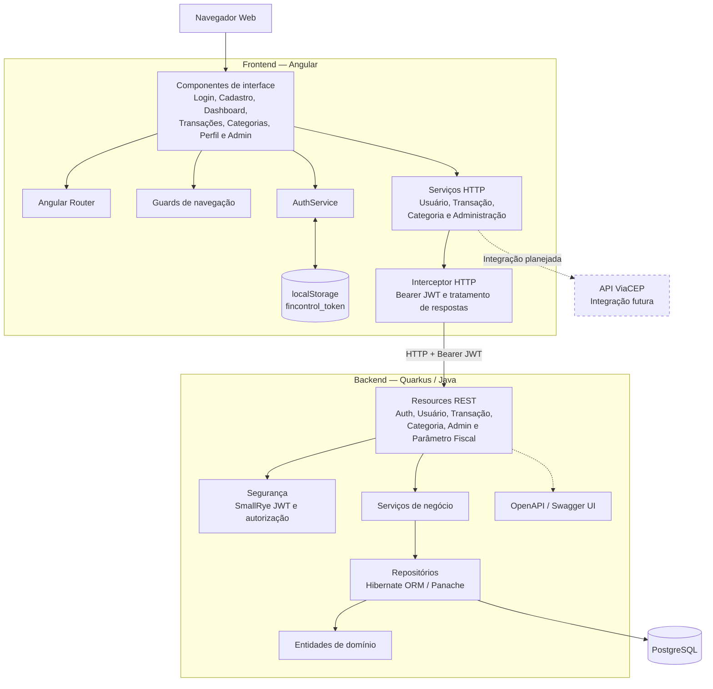

# Diagrama de Componentes — Arquitetura do FinControl

## 1. Objetivo

Este diagrama apresenta a arquitetura macro do FinControl, destacando os componentes do frontend, os componentes do backend e os serviços externos relacionados à aplicação.

A solução é composta por:

- Frontend desenvolvido com Angular.
- Backend desenvolvido com Quarkus e Java.
- Banco de dados PostgreSQL.
- Mecanismo de autenticação baseado em JWT.
- Documentação da API por meio de OpenAPI e Swagger UI.

A integração com ViaCEP é representada como possibilidade futura, não como funcionalidade disponível na versão atual.

## 2. Diagrama

## 3. Componentes do frontend

### 3.1. Interface Angular

Os componentes de interface apresentam os formulários, as telas de consulta e os dados financeiros ao usuário.

Entre as áreas representadas estão:

- Login e cadastro.
- Dashboard financeiro.
- Gestão de transações.
- Gestão de categorias.
- Perfil do usuário.
- Funcionalidades administrativas.

### 3.2. Guards e roteamento

Os guards controlam a navegação de acordo com o estado de autenticação e o perfil do usuário.

Eles ajudam a evitar o acesso indevido às telas pela interface, mas não substituem as verificações de segurança realizadas no backend.

### 3.3. AuthService e armazenamento local

O `AuthService` coordena as operações de autenticação no frontend.

O token recebido do backend é armazenado em `localStorage`, na chave `fincontrol_token`.

### 3.4. Serviços HTTP e interceptor

Os serviços HTTP concentram as chamadas à API.

O interceptor acrescenta o cabeçalho `Authorization: Bearer <token>` às requisições que necessitam de autenticação, conforme a implementação do frontend.

## 4. Componentes do backend

### 4.1. Resources REST

Os resources recebem as requisições HTTP, validam os dados de entrada conforme o contrato da API e encaminham as operações à camada de negócio.

Entre os recursos documentados estão autenticação, usuários, transações, categorias, administração e parâmetros fiscais.

### 4.2. Segurança

O backend utiliza SmallRye JWT para trabalhar com tokens JWT e aplicar as restrições de autorização configuradas.

A segurança deve ser aplicada no servidor, independentemente dos controles existentes no frontend.

### 4.3. Serviços de negócio

Os serviços implementam as regras de negócio e coordenam as operações realizadas sobre as entidades.

Exemplos incluem a validação de propriedade de categorias e transações, a consistência entre tipos financeiros e a validação de períodos de vigência dos parâmetros fiscais.

### 4.4. Persistência

Os repositórios utilizam a camada de persistência baseada em Hibernate ORM e Panache para consultar e modificar os dados armazenados no PostgreSQL.

As entidades representam os objetos persistidos do domínio.

### 4.5. OpenAPI e Swagger UI

A documentação da API é disponibilizada por meio das ferramentas de OpenAPI integradas ao backend.

Essa documentação permite consultar os contratos dos endpoints e apoiar o desenvolvimento e os testes da API.

## 5. Banco de dados

O PostgreSQL armazena os dados persistentes da aplicação, incluindo usuários, categorias, transações e parâmetros fiscais.

O backend é responsável por acessar o banco e aplicar as regras de negócio antes de efetuar as operações.

## 6. Integrações futuras

A integração com ViaCEP aparece no diagrama como evolução planejada.

Sua representação não significa que a consulta de endereço por CEP esteja implementada ou disponível na versão atual.

## 7. Observações técnicas

1. O diagrama é uma visão macro, não um inventário de todos os componentes Angular ou de todas as classes Java.
2. Os nomes das versões de Angular, Quarkus, Java e PostgreSQL devem acompanhar as versões definidas nos arquivos de configuração do repositório.
3. A arquitetura não inclui um endpoint específico de dashboard: os indicadores documentados são calculados no frontend a partir dos dados disponíveis.
4. O frontend público não implica que a API esteja publicamente hospedada. A URL e a disponibilidade do backend dependem da configuração do ambiente.
5. As futuras integrações devem ser diferenciadas visualmente dos componentes implementados.