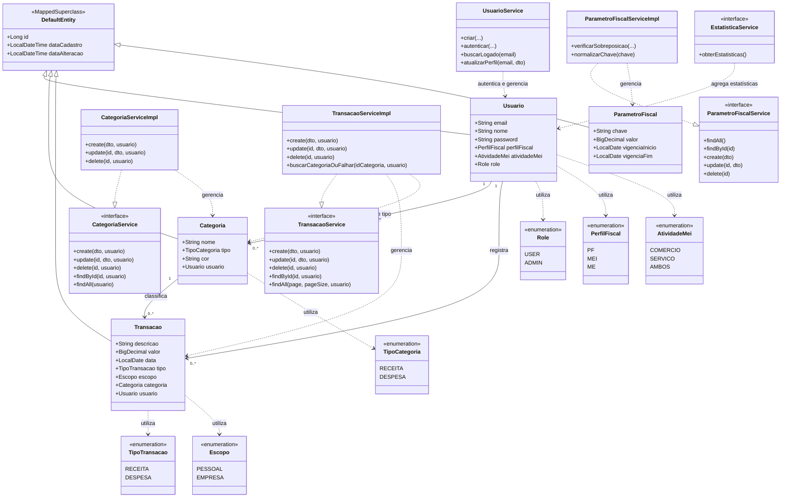

# Diagrama de Classes — FinControl

## 1. Objetivo

Este diagrama apresenta as principais classes do domínio do FinControl, seus relacionamentos e as abstrações de serviço responsáveis pelas regras de negócio.

A modelagem contempla:

- Entidades persistidas no PostgreSQL.
- Relacionamentos entre usuários, categorias e transações.
- Enumerações utilizadas para representar perfis, tipos e escopos.
- Serviços responsáveis pela autenticação e pelas operações financeiras.
- Serviços administrativos relacionados às estatísticas e aos parâmetros fiscais.

Os serviços são apresentados separadamente das entidades persistentes, pois possuem responsabilidades distintas na arquitetura da aplicação.

## 2. Diagrama

## 3. Descrição das classes

### 3.1. Entidades

| Classe | Responsabilidade |
|---|---|
| `DefaultEntity` | Classe-base que reúne atributos comuns de identificação e auditoria das entidades. |
| `Usuario` | Representa a conta do usuário, suas credenciais, seu perfil de acesso e suas informações fiscais. |
| `Categoria` | Representa uma categoria utilizada para classificar receitas ou despesas. |
| `Transacao` | Representa uma movimentação financeira, incluindo valor, data, tipo, escopo e categoria. |
| `ParametroFiscal` | Armazena parâmetros fiscais com valores e períodos de vigência. |

### 3.2. Enumerações

| Enumeração | Valores representados | Finalidade |
|---|---|---|
| `Role` | `USER`, `ADMIN` | Define o perfil de autorização do usuário. |
| `PerfilFiscal` | `PF`, `MEI`, `ME` | Representa o perfil fiscal do usuário. |
| `AtividadeMei` | `COMERCIO`, `SERVICO`, `AMBOS` | Representa a atividade cadastrada para o perfil MEI. |
| `TipoCategoria` | `RECEITA`, `DESPESA` | Define a natureza financeira da categoria. |
| `TipoTransacao` | `RECEITA`, `DESPESA` | Define a natureza financeira da transação. |
| `Escopo` | `PESSOAL`, `EMPRESA` | Diferencia movimentações pessoais e empresariais. |

Os valores apresentados representam a modelagem documentada para o projeto. A lista definitiva deve acompanhar as declarações existentes no código-fonte.

### 3.3. Serviços

| Serviço | Responsabilidade |
|---|---|
| `UsuarioService` | Gerencia operações de usuário e participa do processo de autenticação. |
| `CategoriaService` | Define o contrato das operações de gerenciamento de categorias. |
| `CategoriaServiceImpl` | Implementa as operações de categorias, respeitando as regras de propriedade e exclusão. |
| `TransacaoService` | Define o contrato das operações de transações financeiras. |
| `TransacaoServiceImpl` | Implementa as operações financeiras e valida a categoria associada à transação. |
| `ParametroFiscalService` | Define as operações de consulta e gerenciamento dos parâmetros fiscais. |
| `ParametroFiscalServiceImpl` | Implementa as operações dos parâmetros e as validações de vigência. |
| `EstatisticaService` | Define as operações de consulta das estatísticas administrativas. |

## 4. Relacionamentos e regras de negócio

### 4.1. Usuário e categorias

Um usuário pode possuir nenhuma ou várias categorias. Cada categoria está associada ao usuário responsável por ela.

### 4.2. Usuário e transações

Um usuário pode registrar várias transações. As operações financeiras devem respeitar a propriedade dos registros, impedindo que um usuário comum consulte ou altere transações pertencentes a outra conta.

### 4.3. Categoria e transações

Uma categoria pode classificar várias transações. Antes de associar uma categoria a uma transação, o backend deve verificar se ela pertence ao usuário autenticado e se seu tipo é compatível com o tipo da transação.

Uma categoria que possui transações vinculadas não pode ser excluída.

### 4.4. Parâmetros fiscais

Os parâmetros fiscais são utilizados pela área administrativa e não possuem associação direta com um usuário no modelo apresentado.

O serviço responsável verifica a consistência dos períodos de vigência, evitando sobreposições indevidas conforme as regras implementadas.

### 4.5. Serviços e entidades

Os serviços aplicam as regras de negócio e coordenam as operações sobre as entidades. As entidades representam os dados do domínio, enquanto os serviços não são, por si só, registros persistidos no banco de dados.

## 5. Observações técnicas

1. O diagrama é uma visão simplificada do modelo, não uma listagem de todos os atributos e métodos existentes no código.
2. DTOs, recursos REST, repositórios e classes auxiliares foram omitidos para facilitar a leitura.
3. Os nomes e as assinaturas de métodos devem ser conferidos no backend antes de uma alteração estrutural.
4. A presença de `PerfilFiscal` e de parâmetros fiscais não significa que os cálculos tributários de PF, MEI e ME estejam implementados.
5. A classe `EstatisticaService` representa a camada responsável pelas estatísticas administrativas, não um endpoint REST.
6. O diagrama deve ser atualizado sempre que houver alterações nas entidades, nos relacionamentos ou nos serviços.