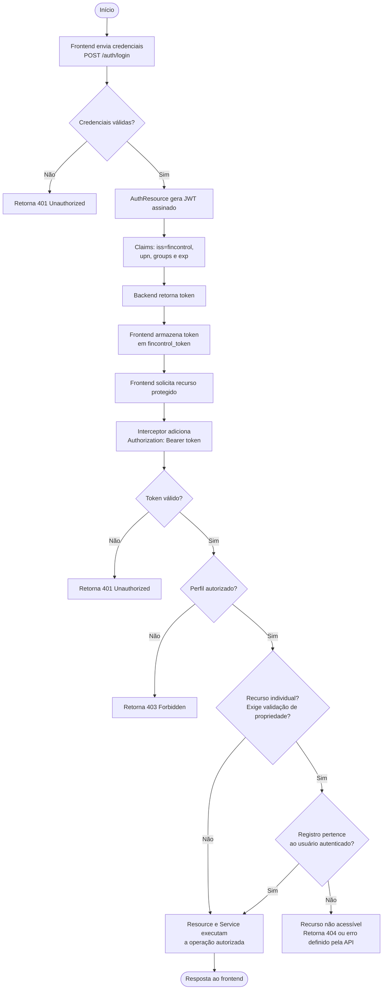

# Diagrama de Fluxo JWT — Autenticação e Autorização

## 1. Objetivo

Este diagrama apresenta o processo de emissão, armazenamento e validação do token JWT utilizado pelo FinControl.

Também representa as verificações necessárias para permitir ou rejeitar operações protegidas.

O processo de autorização considera três aspectos:

- Validade do token.
- Permissão do perfil para acessar o recurso.
- Propriedade do registro financeiro solicitado, quando aplicável.

## 2. Diagrama

## 3. Etapas do processo

### 3.1. Autenticação e emissão

O frontend envia as credenciais ao endpoint `POST /auth/login`.

Se as credenciais forem válidas, o backend gera um JWT assinado. O token contém as informações necessárias à identificação do usuário, ao controle de validade e à autorização.

O emissor configurado é `fincontrol`, e o período de validade documentado é de uma hora.

### 3.2. Armazenamento do token

O frontend armazena o token em `localStorage`, utilizando a chave `fincontrol_token`.

Nas chamadas subsequentes aos endpoints protegidos, o interceptor HTTP adiciona o cabeçalho:

`Authorization: Bearer <token>`

### 3.3. Validação do token

O backend valida o token recebido de acordo com sua configuração de segurança, incluindo a assinatura, a validade temporal e o emissor.

Tokens ausentes, inválidos ou expirados não devem autorizar a execução da operação protegida.

### 3.4. Autorização por perfil

Após validar a identidade, o backend verifica se o perfil possui autorização para acessar o endpoint solicitado.

As restrições podem ser declaradas por meio das anotações de segurança, como `@RolesAllowed`.

Uma falha de autorização por perfil normalmente resulta em `403 Forbidden`.

### 3.5. Verificação de propriedade

Para operações sobre transações e categorias, a aplicação também verifica se o recurso pertence ao usuário autenticado.

A posse de um JWT válido não concede acesso automático aos registros de outros usuários.

Quando um registro não pertence ao usuário, o backend deve impedir a operação. A resposta específica — por exemplo, `404 Not Found` para evitar revelar a existência de um recurso — depende do contrato e do tratamento de erros implementados pela API.

## 4. Significado dos códigos HTTP

| Código | Significado geral | Situação |
|---|---|---|
| `200 OK` | Requisição concluída com sucesso. | Consulta ou operação realizada com sucesso. |
| `201 Created` | Recurso criado. | Cadastro realizado com sucesso, quando definido pelo endpoint. |
| `400 Bad Request` | Dados da requisição inválidos. | Validação de entrada falhou. |
| `401 Unauthorized` | Autenticação ausente ou inválida. | Token inválido, expirado ou credenciais inválidas. |
| `403 Forbidden` | Acesso não permitido. | Usuário autenticado sem a permissão exigida. |
| `404 Not Found` | Recurso não encontrado ou não exposto ao solicitante. | Registro inexistente ou protegido por regra de propriedade. |

Os códigos efetivamente retornados podem variar conforme o endpoint e o tratamento de exceções implementado.

## 5. Considerações de segurança

1. A autenticação e a autorização devem ser verificadas no backend.
2. Guards Angular ajudam na navegação, mas não substituem a proteção dos endpoints.
3. O serviço deve validar a propriedade de cada registro individual antes de permitir consultas ou alterações.
4. As estatísticas administrativas devem respeitar o escopo agregado previsto pelo sistema.
5. O armazenamento de JWT em `localStorage` exige atenção a ataques de XSS, pois scripts executados na origem podem acessar esse armazenamento.
6. O token não deve ser enviado em URLs nem exposto em logs.
7. As chaves privadas utilizadas na assinatura do JWT devem permanecer protegidas e fora do controle de versão.

## 6. Limites do diagrama

Este diagrama descreve o fluxo conceitual de segurança. Não substitui a configuração real do Quarkus, as anotações de autorização presentes nos recursos nem os testes automatizados dos endpoints.

A resposta HTTP exata para cada falha deve ser confirmada na implementação.