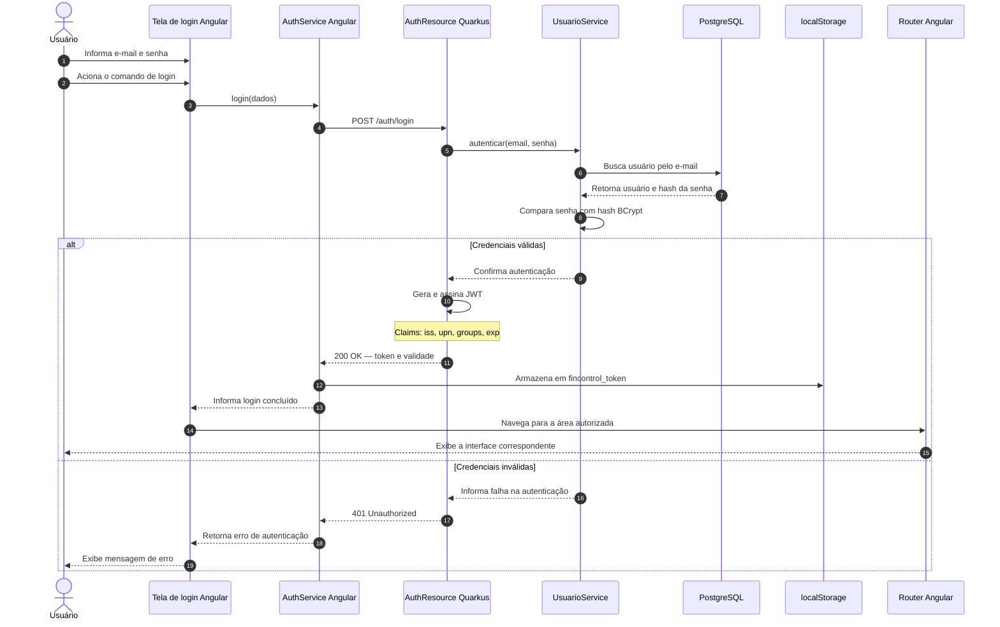

# Diagrama de Sequência — Login e Autenticação JWT

## 1. Objetivo

Este diagrama representa a sequência de interações necessária para autenticar um usuário no FinControl.

O fluxo abrange:

1. O envio das credenciais pela interface Angular.
2. A chamada ao endpoint de autenticação do backend.
3. A validação das credenciais pelo serviço de usuário.
4. A emissão do token JWT após a autenticação bem-sucedida.
5. O armazenamento do token no frontend.
6. O tratamento de credenciais inválidas.

O token JWT é utilizado para identificar o usuário nas requisições protegidas subsequentes.

## 2. Diagrama

## 3. Descrição do fluxo

### 3.1. Envio das credenciais

O usuário informa seu e-mail e sua senha na interface Angular. O serviço de autenticação do frontend envia os dados para o endpoint `POST /auth/login`.

### 3.2. Validação no backend

O `AuthResource` encaminha as credenciais ao `UsuarioService`, responsável por localizar o usuário e validar a senha.

A senha informada é comparada com o hash armazenado utilizando BCrypt. A senha em texto simples não deve ser armazenada no banco de dados.

### 3.3. Emissão do token

Quando as credenciais são válidas, o backend emite um token JWT assinado com a chave privada configurada.

O token contém os seguintes elementos documentados:

| Claim | Finalidade |
|---|---|
| `iss` | Identifica o emissor do token, configurado como `fincontrol`. |
| `upn` | Identifica o usuário no contexto de autenticação. |
| `groups` | Representa os grupos ou perfis utilizados na autorização. |
| `exp` | Define o instante de expiração do token. |

A validade configurada para o token é de uma hora.

### 3.4. Armazenamento e navegação

Após receber uma resposta de autenticação bem-sucedida, o frontend armazena o token na chave `fincontrol_token` do `localStorage`.

Em seguida, a interface realiza a navegação para a área apropriada. As permissões também devem ser verificadas no backend; a navegação no frontend não constitui uma barreira de segurança suficiente.

### 3.5. Falha na autenticação

Se as credenciais forem inválidas, o backend retorna `401 Unauthorized`. O frontend recebe a resposta e apresenta uma mensagem de erro ao usuário.

## 4. Segurança e responsabilidades

- O backend é responsável por validar as credenciais e assinar o token.
- O frontend é responsável por armazenar o token e utilizá-lo nas requisições subsequentes.
- O token é enviado pelo frontend no cabeçalho HTTP `Authorization`, com o esquema `Bearer`.
- O backend valida a assinatura e a validade do token nas requisições protegidas.
- A autorização deve ser aplicada no backend, de acordo com o perfil do usuário e as regras de propriedade dos dados.
- O token não deve ser registrado em logs nem exposto em mensagens de erro.

## 5. Observações

1. O diagrama não representa o processo de criação de conta, embora exista um endpoint específico para cadastro.
2. O logout atual remove o token armazenado no frontend; não existe endpoint de logout no backend.
3. A chave `fincontrol_token` corresponde ao armazenamento documentado no frontend.
4. O redirecionamento específico pode variar conforme a configuração das rotas Angular. Por isso, o diagrama representa a navegação para a área autorizada sem presumir nomes de rotas.
5. A expiração do token exige uma nova autenticação quando não houver mecanismo adicional de renovação implementado.